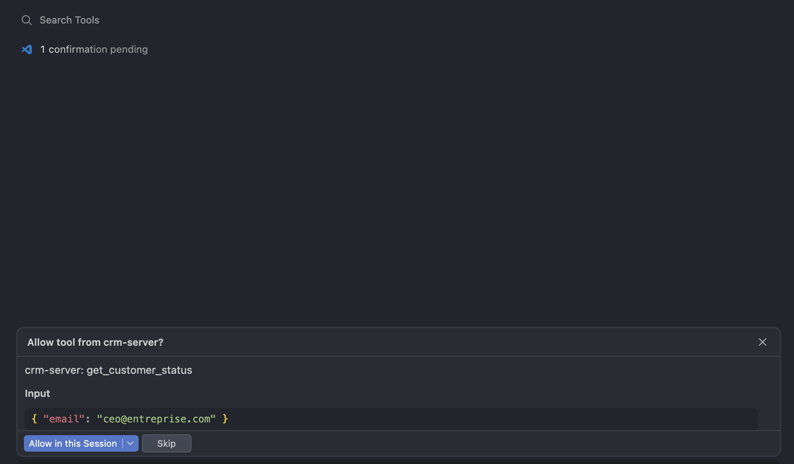
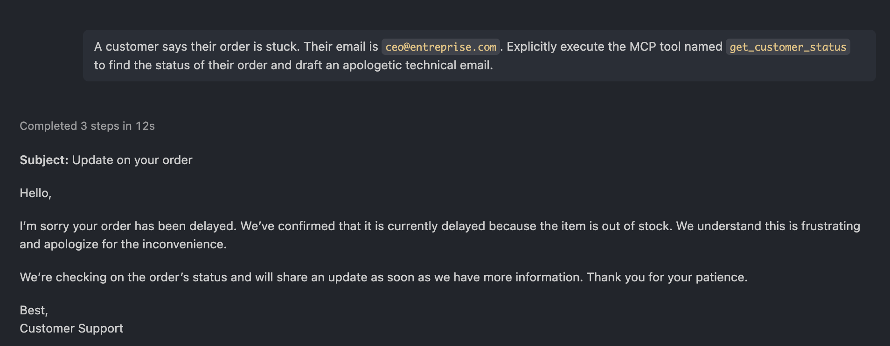
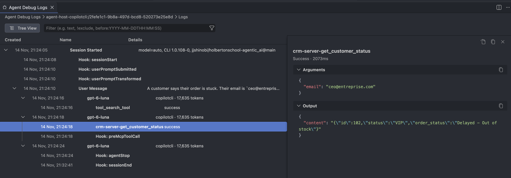

## 1. The “Customer Support” Agent (Executing a Read Tool)

### Customer order status inquiry

- **Prompt used:** “A customer says their order is stuck. Their email is `ceo@entreprise.com`. Explicitly execute the MCP tool named `get_customer_status` to find the status of their order and draft an apologetic technical email.”
- **MCP tool executed:** `get_customer_status`
- **Order status returned by the CRM:** `Delayed - Out of stock`
- **Email draft generated by the Agent:**

  **Subject:** Update on your order

  Hello,

  I’m sorry your order has been delayed. We’ve confirmed that it is currently delayed because the item is out of stock. We understand this is frustrating and apologize for the inconvenience.

  We’re checking on the order’s status and will share an update as soon as we have more information. Thank you for your patience.

  Best,  
  Customer Support

### Session screenshots

