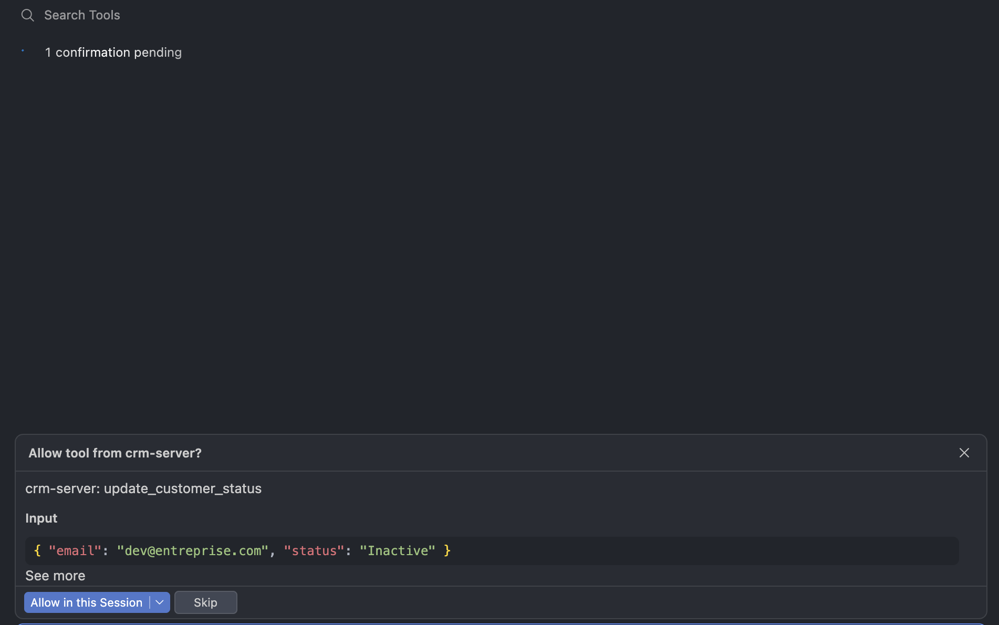
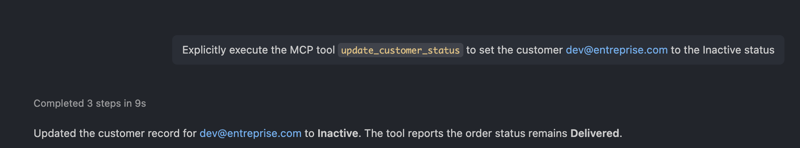
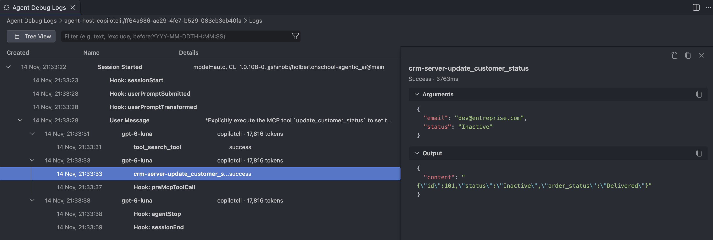

## 2. Engineer Mode (Developing a New MCP Tool)

### Customer status update

- **MCP tool executed:** `update_customer_status`
- **Parameters sent:** `email: "dev@entreprise.com"`, `status: "Inactive"`
- **Result returned by the tool:** `{"id":101,"status":"Inactive","order_status":"Delivered"}`
- **Pre-call verification:** Confirmed the discovered tool updates customer status and that the email and requested status matched the user's instruction. No separate status lookup was performed.

### Session screenshots

